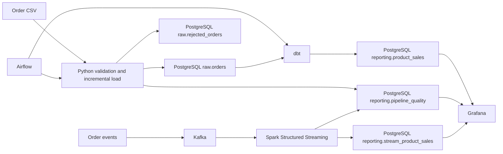

# Retail & E-Commerce Data Pipeline

## Overview
Analyze orders, product revenue and inventory using synthetic data. Run the dependency-free Python and SQLite demo or the Docker Compose portfolio stack.

## Data quality rules
Quantity, unit price and stock must be nonnegative, and prices and row totals must be finite. Each row needs a product ID. Invalid rows are quarantined in `output/rejected.json`. If every row is rejected, the clean output, warehouse table and summary are empty. A malformed CSV or a missing required column stops the run.

## Architecture
```text
Synthetic CSV -> Python validation and transformation -> JSONL + SQLite -> SQL aggregates -> JSON report
```

## Quick start
Requires Python 3.10+. No third-party packages required. From this repository's root:

```bash
python3 -m src.pipeline
python3 -m unittest discover -s tests -v
```

Results are written to `output/`: `clean.jsonl`, `rejected.json`, `warehouse.db`, and `summary.json`.

## SQL
Open `output/warehouse.db` with any SQLite client and run `sql/analysis.sql`.

## Repository structure
- `data/input.csv`: small synthetic dataset
- `src/pipeline.py`: ETL pipeline and aggregation
- `tests/`: Python unit tests and Docker integration tests for PostgreSQL, dbt, Kafka and Spark
- `.github/workflows/ci.yml`: test automation for pushes and pull requests
- `sql/analysis.sql`: reporting query
- `compose.yaml`: PostgreSQL, Airflow and Grafana, with an optional Kafka and Spark profile
- `dbt/models/`: staging and product sales models with data quality tests
- `src/load_postgres.py` and `src/stream_orders.py`: PostgreSQL batch loading and Spark stream processing
- `output/`: generated artifacts (gitignored)

## Portfolio stack



### Batch

With Docker and Docker Compose installed, start the stack from the repository root.

```bash
docker compose up -d --build
docker compose exec -T airflow cat /opt/airflow/simple_auth_manager_passwords.json.generated
```

After Airflow starts, the command above prints the generated admin password. Open http://localhost:8080, sign in, enable the `retail_batch` DAG and trigger it. It also runs daily at midnight UTC while enabled. The DAG first validates and inserts new CSV records. PostgreSQL commits accepted rows, quarantined rows, metrics and the CSV checkpoint together. The loader verifies the SHA-256 of the committed byte prefix, then parses from the saved byte offset. Append complete UTF-8 CSV records ending in a newline to `data/input.csv`. Keep the original header and history intact. A changed or shortened prefix fails the load and leaves the warehouse intact.

The DAG then runs `dbt build`. On the first run dbt builds the product sales table. Later runs use the highest processed accepted source row to identify affected products, recalculate those products from their full order history, and leave other product rows in place. This keeps product totals correct when additional order lines arrive.

Open Grafana at http://localhost:3000/d/retail-sales/retail-sales with the local demo login `admin` / `retail_demo`. With the bundled source file, the CSV panel shows P1 with 5 units and 77.50 revenue and P2 with 1 unit and 80.00 revenue. The dashboard's PostgreSQL account has read access to the reporting schema.

### Upgrading an existing warehouse

For an existing PostgreSQL volume, apply the schema migration before running the updated loader or Spark job. Newly created volumes apply it at initialization.

```bash
docker compose exec -T warehouse psql -v ON_ERROR_STOP=1 -U retail -d retail < infra/postgres/upgrade.sql
docker compose --profile streaming up -d --build
```

The first CSV run with an existing raw table checks the existing accepted and rejected rows against the file before setting the checkpoint. Keep the CSV used for the last snapshot, with any new records appended. The migration adds the watermark column to an existing product sales table. Run a one-time `dbt build --full-refresh` if the old mart contains stale products from earlier snapshots.

### Streaming

Start the optional Kafka broker and Spark worker. The first Spark launch downloads its Kafka connector.

```bash
docker compose --profile streaming up -d --build
docker compose --profile streaming logs -f spark
```

From a second terminal, publish a sample order event to the `retail-orders` topic.

```bash
printf '%s\n' '{"event_id":"EV-1","event_time":"2025-01-01T12:00:00Z","product_id":"P1","quantity":2,"unit_price":15.50}' |
  docker compose --profile streaming exec -T kafka /opt/kafka/bin/kafka-console-producer.sh --bootstrap-server kafka:9092 --topic retail-orders
```

Refresh the Grafana dashboard. Its Kafka panel should show P1 with 1 event and 31.00 revenue. PostgreSQL deduplicates retries using the Kafka topic, partition and offset, and repeated valid events using their event IDs. Invalid payloads stay in `raw.stream_orders` with a null event ID. The Kafka panel reports only valid events. Spark uses its checkpoint to resume consumption across restarts.

```bash
docker compose exec -T warehouse psql -U retail -d retail -c 'TABLE reporting.stream_product_sales;'
```

Spark uses two local threads, bounded micro-batches and a persistent checkpoint. The PostgreSQL sink writes each micro-batch through one connection. This setup demonstrates streaming on one machine. The Kafka panel and CSV panel report separate datasets.

Stop the stack while retaining its named volumes with `docker compose --profile streaming down`. The original Python and SQLite quick start still runs independently of Docker.

## Data quality and observability

The PostgreSQL CSV loader also requires a nonblank order ID. Spark validates event ID, product ID, event time, quantity and price. The batch rejection table keeps the source record number, payload and reason. The stream table keeps the Kafka topic, partition, offset and payload for invalid messages.

The Grafana dashboard shows counts, error rate and processing duration for each committed CSV run and nonempty Kafka micro-batch. The error rate is `rows_rejected / rows_seen`, with a rate of zero for an empty CSV run. Both jobs emit a `pipeline_run` JSON log after PostgreSQL commits. A rate strictly above `DQ_ERROR_RATE_THRESHOLD` sets the alert flag and records the log at `WARNING` level. The threshold is a fraction from 0 to 1 and defaults to 0. For example, `DQ_ERROR_RATE_THRESHOLD=0.05 docker compose --profile streaming up -d` alerts when more than 5% of the records in a run or micro-batch are invalid.

A failed load or micro-batch emits a `pipeline_run_failed` JSON log at `ERROR` level with the pipeline name, elapsed time, exception type and Kafka batch ID when available. PostgreSQL rolls back the transaction, including any new checkpoint and metrics rows, and the error propagates to Airflow or Spark.

```bash
docker compose logs airflow spark
docker compose exec -T warehouse psql -U retail -d retail -c \
  'SELECT * FROM reporting.pipeline_quality ORDER BY run_id DESC LIMIT 20;'
```

For the CSV job, the task logs are available from the Airflow task instance. dbt emits its model and test results in the same DAG. `rows_written` includes accepted and quarantined records. For Kafka, `rows_skipped` counts duplicates suppressed by the sink, including any replayed offsets. If Spark retries after PostgreSQL commits and before Spark saves its checkpoint, the stream records stay deduplicated and the metrics appear once per committed attempt.

## Automated tests

```bash
python3 -m unittest discover -s tests -v
bash tests/run_integration.sh
```

The Python suite covers validation, the standalone ETL, and quality metrics and alerts. The Docker suite tests CSV loading against PostgreSQL, checkpoint adoption and rollback after a partial write, dbt unit and data tests, incremental aggregates, Spark parsing, and Kafka-to-PostgreSQL ingestion before and after a Spark restart. It creates and removes its own Compose project and volumes. GitHub Actions runs both suites on pushes and pull requests via `.github/workflows/ci.yml`. The workflow also supports manual runs from the Actions tab.

## Limitations

- The CSV source is append-only. Corrections, deletions and source rotation require a controlled rebuild. Verifying the byte prefix still reads historical bytes, while validation and insertion run on new records. dbt reads order history for the products that changed.
- Appends should be completed before the scheduled load. The warehouse assumes one dbt writer. The Airflow DAG enforces this for scheduled and manually triggered DAG runs.
- The Spark driver writes each bounded micro-batch to PostgreSQL through one connection. Kafka retention and the checkpoint volume determine how far back the stream can resume. The batch and streaming reports represent separate datasets.
- Alerts are recorded in PostgreSQL and logs. The demo runs on one machine with synthetic data and local credentials.
